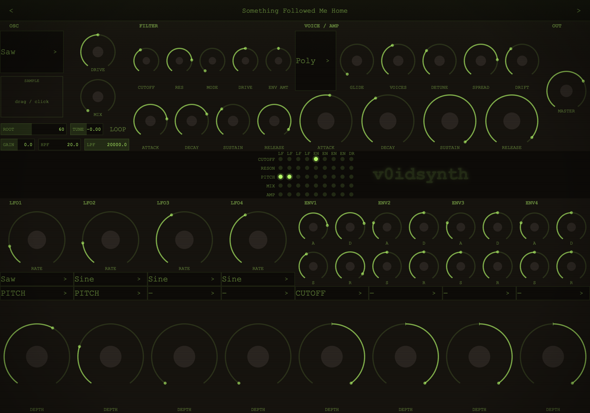
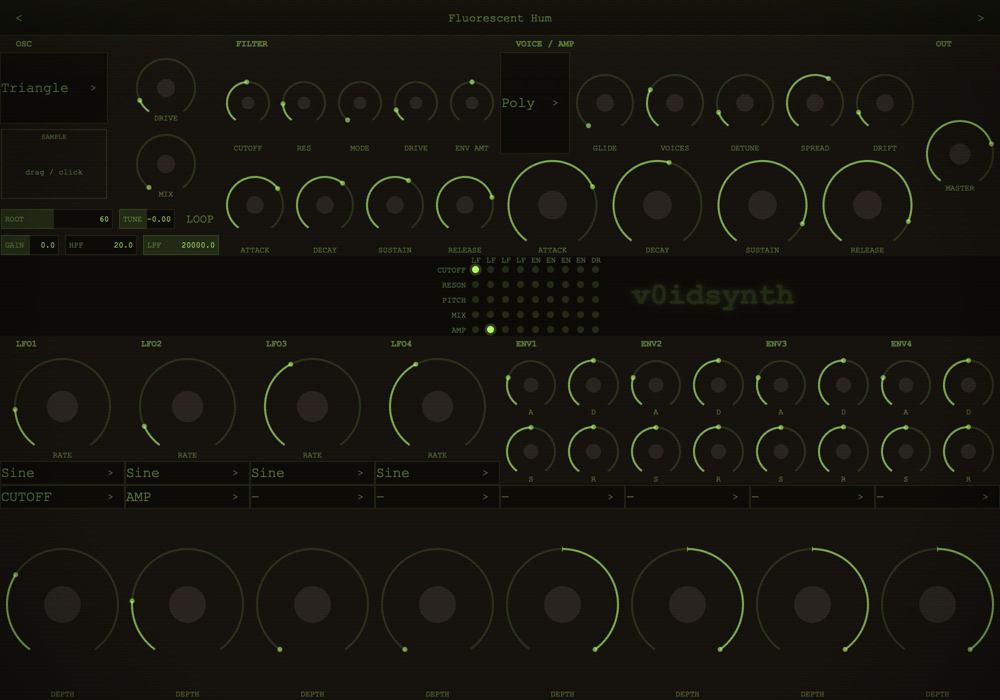
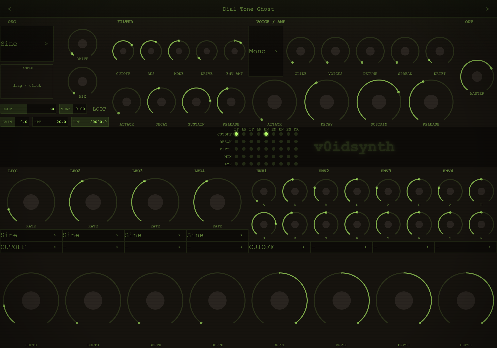

# v0idsynth

**A 16-voice software synthesizer for analog-horror, liminal-space and weirdcore sounds.
macOS Audio Unit, built with JUCE.**



> *Every sound should feel like it exists somewhere between the beautiful and the deeply
> wrong: lush enough to feel safe, degraded enough to feel haunted.*

v0idsynth is built for fluorescent-hum pads, basement-pulse basses, dial-tone leads and
unsettling FX textures. It has **no built-in effects**. Instead of reverb, chorus or delay
inserts, all of its character comes from oscillator design and a deep modulation system:
slow LFOs, envelopes and per-voice analog drift. The wobble, unease and decay are part of the
patch itself.

The UI is a dim, CRT-green control panel with a live mod-matrix grid that shows which sources
drive which destinations.

---

## Features

- **Two oscillators, blendable**
  - *Osc 1*: band-limited analog waveforms (saw, square, triangle, sine) with pre-filter drive.
  - *Osc 2*: a sample oscillator. Drag in (or click to load) WAV, AIFF, FLAC, MP3, OGG, M4A or
    CAF, then set the root note, fine tune, gain, loop and per-sample HP/LP filters. Your own
    field recordings, choirs or tape hiss become playable instruments.
- **Multi-mode filter**: a ladder-filter core with saturation that crossfades smoothly
  between LP → HP → BP → Notch. It has its own ADSR with bipolar envelope amount.
- **Voice modes**
  - *Poly*: 16 voices. Voice stealing prefers releasing voices, so long pads don't cut off.
  - *Mono*: with glide.
  - *Unison*: 1–8 stacked voices with detune and stereo spread.
- **Per-voice drift**: each voice slowly wanders off pitch on its own, like an old analog
  synth that was never quite in tune.
- **Modulation matrix**: 4 LFOs (sine, triangle, saw, square, S&H; 0.01–20 Hz), 4 ADSR mod
  envelopes, and drift. Any of them can be routed to cutoff, resonance, pitch, osc mix or amp,
  each with its own depth. It's lock-free and real-time safe.
- **39 factory presets** in six categories:
  - *Pads*: Fluorescent Hum, Wrong Room, Exit Sign Flicker, Lobby at 3am, The Painting Is
    Watching, Fever Architecture
  - *Basses*: Parking Structure B, Basement Pulse, Low Voltage, Weight of the Ceiling,
    Server Room Hum, Maintenance Shaft
  - *Leads*: Static Remembers, Call Box Drone, Dial Tone Ghost, Unanswered, The Long
    Corridor, Frequency Sickness
  - *FX*: Something Followed Me Home, Pneumatic Door, Security Camera Buzz, Cassette That
    Won't Rewind, Maintenance Required, Signal Decay, Wrong Number, Body in the Walls,
    Teeth on Concrete
  - *Organic*: Breath in Walls, Carpet Static, Old Intercom, Water Finding Its Level, Flies
    in the Fixture, Mechanical Lung
  - *Sample templates*: ready-made patches for your own samples (Drone Bed, String Haunt,
    Field Recording, Choir of Ghosts, Mechanical Clock, Borrowed Tape)

| Fluorescent Hum (pad) | Dial Tone Ghost (lead) |
|---|---|
|  |  |

## Project layout

```
Source/
  DSP/          analog oscillator, sample oscillator, multi-mode filter, drive
  Engine/       synth voice, sample bank + background loader, parameter cache
  Modulation/   LFOs, mod envelopes, mod-matrix table + engine
  Preset/       preset manager and browser
  UI/           section components, mod-routing display, look-and-feel
Resources/Presets/   factory presets (XML, embedded at build time)
Tests/               Catch2 unit tests
```

Parameter IDs are stable and versioned, so saved projects and automation stay valid across
updates. [`PARAMETER_STRATEGY.md`](PARAMETER_STRATEGY.md) has the full parameter table.

## Building

Requirements: macOS 12+, Xcode command-line tools, CMake 3.22+.

```bash
git clone --recursive https://github.com/kolotammaman/v0idsynth.git
cd v0idsynth
cmake -B build -G Xcode
cmake --build build --config Release --target v0idsynth_AU
```

JUCE 8.0.12 is included as a git submodule. If you cloned without `--recursive`, run
`git submodule update --init` first. The build produces a universal (arm64 + x86_64)
`v0idsynth.component` and copies it to `~/Library/Audio/Plug-Ins/Components/`. Rescan AU
plugins in Logic or your DAW of choice to pick it up.

To build and run the unit tests (CMake downloads Catch2 automatically):

```bash
cmake --build build --config Release --target v0idsynth_tests
./build/Release/v0idsynth_tests
```

## License

[AGPL-3.0](LICENSE). Built on [JUCE](https://juce.com), which is used under its AGPLv3 license.

---

*Designed and built by molo in collaboration with Claude.*
